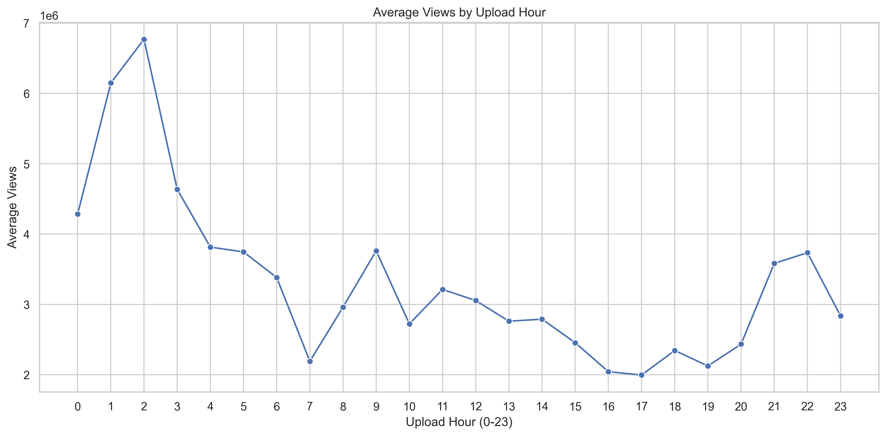
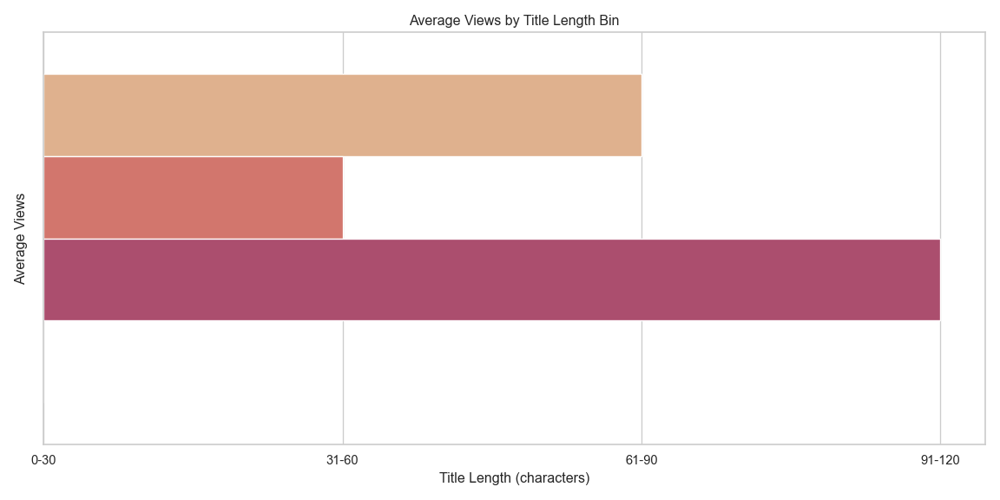
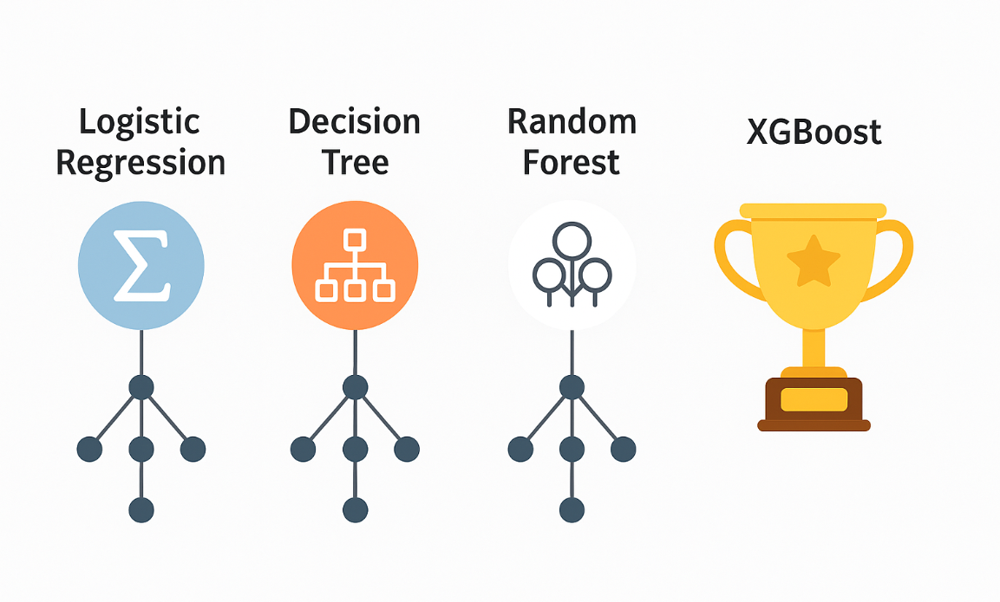
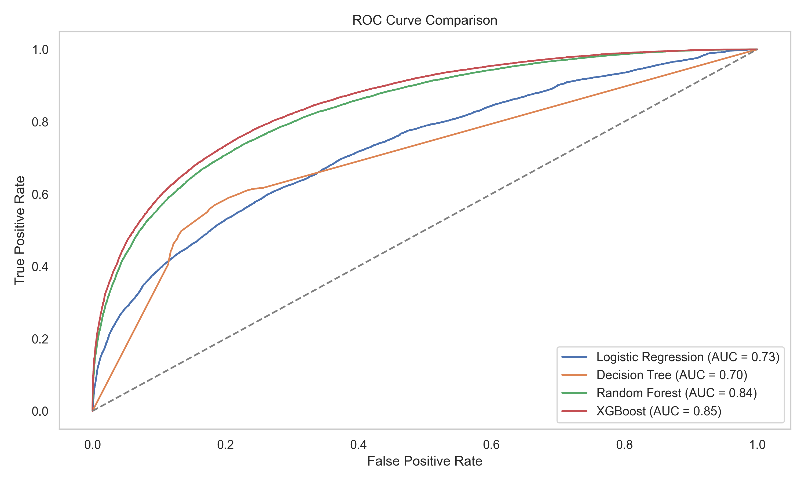

```{python}
#| label: load-packages
#| include: false

# Load packages here
import pandas as pd
import seaborn as sns
import matplotlib.pyplot as plt
import numpy as np
from sklearn.model_selection import train_test_split,RandomizedSearchCV
from sklearn.linear_model import LogisticRegression
from sklearn.tree import DecisionTreeClassifier
from sklearn.ensemble import RandomForestClassifier
from sklearn.metrics import classification_report, roc_auc_score, confusion_matrix, roc_curve,auc,ConfusionMatrixDisplay
from googleapiclient.discovery import build
from dotenv import load_dotenv
import os
import isodate
from xgboost import XGBClassifier

```

```{python}
#| label: setup
#| include: false
#| 
# Set up plot theme and figure resolution
sns.set_theme(style="whitegrid")
sns.set_context("notebook", font_scale=1.1)

import matplotlib.pyplot as plt
plt.rcParams['figure.dpi'] = 300
plt.rcParams['savefig.dpi'] = 300
plt.rcParams['figure.figsize'] = (6, 6 * 0.618)
```

# What & Why

:::{.columns}

::: {.column width="65%"}
**What are we solving?**  
Can we predict whether a YouTube video will get high engagement using just its metadata?

**Why does it matter?**  
- ⏰ Timing, title, and early traction can make a huge difference  
- 🧑‍🏫 Creators can optimize effort and boost visibility  
- 📈 Modeling can guide strategy and platform recommendations
:::

::: {.column width="35%"}
{width=100%}
:::

:::

# How We Approached It
:::{.columns}
::: {.column width="100%"}
- 🧹 Cleaned and explored video metadata  
- 🛠️ Engineered features: `title_length`, `upload_hour`, `like_ratio`, `duration_minutes`  
- 🎯 Framed task as binary classification (top 25% views = high engagement)  
- 🤖 Trained Logistic Regression, Decision Tree, Random Forest and **XGBoost**
- 🧪 Compared using Accuracy and ROC-AUC
:::
:::

# The Dataset

:::{.columns.with-divider}
::: {.column width="40%" .bordered}
- 📦 Source:

  India YouTube Trending Video Dataset (Kaggle)

- 📊 Size:

  251,277 rows across 16 columns
  ~78,847 unique videos
:::
::: {.column width="52%"}
- 🛠️ Key Features Used:
    - title_length
    - upload_hour
    - like_ratio
    - trending_days
    - duration_minutes (from API subset)
:::
🔍 Focused only on metadata available before a video trends
:::

# EDA Insight: When to Upload?
::: {.column width="100%"}
- 🌙 Highest average views are for videos uploaded **between midnight and 3 AM**
- 🌅 View counts steadily drop during the day and hit a **low in the evening**
- 📌 Upload timing may impact visibility - uploading early may improve reach
:::

## {.no-title-slide }

<div style="text-align: center;">
{width=60%}
</div>


# EDA Insight 2 – Title Length vs. View Count
::: {.column width="100%"}
📌 **Insight:**  
- Longer titles (91–120 characters) get the most views  
- Very short titles (31–60) perform the worst  
- 0–30 and 61–90 ranges perform moderately well<br>


💡 **Takeaway:**  
Longer, descriptive titles may help a video attract more engagement
:::

## {.no-title-slide}



# Modeling Summary

::: {.column width="60%"}
<span style="font-size: 85%;">
🧠 **Models Tried:**
</span>

<span style="font-size: 80%;">
- Logistic Regression  
- Decision Tree  
- Random Forest  
- XGBoost (with hyperparameter tuning)
</span>

:::
::: {.column width="40%"}
<span style="font-size: 85%;">
🏆 **Top Performer: XGBoost**  
</span>
<span style="font-size: 80%;">
- ROC AUC: **0.85**  
- Accuracy: **0.78**
</span>
:::
<div style="text-align: center;">
{height=350px}
</div>

# Evaluation Highlights
<span style="font-size: 90%;">

::: columns
::: {.column width="50%".bordered}

📊 **Tuned XGBoost using RandomizedSearchCV**  
- `max_depth = 7`  
- `n_estimators = 200`  
- `learning_rate = 0.2`  
- `scale_pos_weight = 3`

:::

::: {.column width="40%"}

📈 **Class 1 Performance**  
- Precision: **0.55**  
- Recall: **0.74**  
- ROC AUC: **0.85**  
- Accuracy: **0.78**

:::
🧠 XGBoost balances depth and learning rate to handle imbalanced labels effectively.  
📌 High recall on positive class helps flag trending videos better.  
🎯 Still room to improve precision using advanced tuning.
:::
</span>

## {.no-title-slide}
{width=100%}


## Key Takeaways & Reflection

- 📊 Metadata alone (like title, upload hour, like ratio) has strong predictive value
- 🕗 Upload hour and 📏 title length showed clear patterns during EDA
- 🧠 XGBoost delivered the best results (ROC AUC: **0.85**) after tuning
- ⚖️ We addressed class imbalance and refined noisy engagement signals
- 📎 Extra features like video duration (via API) supported richer insights

---

### What I Learned

::: {.column width="60%"}

- 🧪 Combining datasets improved both context and quality
- 🧹 Feature engineering can be more impactful than just model choice
- 📦 Reproducible workflows (like Quarto + Jupyter) made storytelling smoother
:::

::: {.column width="40%"}

:::
---

### What’s Next
::: {.column width="70%"}
- 🔄 Try deeper model tuning and ensemble techniques
- 💬 Use NLP to analyze video titles and tags
- 📈 Apply model suggestions to real-world content strategy
:::
::: {.column width="30%"}

:::